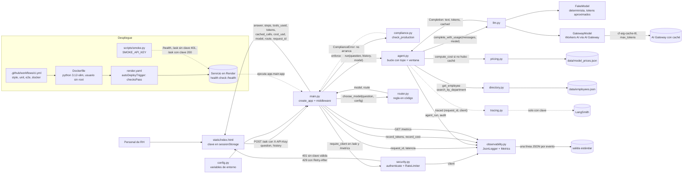

# Arquitectura del HR Assistant

Este documento describe solo lo que existe hoy en `product/` (sesiones 1 a 4).

API web sin estado de negocio con un solo agente y dos herramientas de solo lectura. El modelo está detrás de una interfaz. Un enrutador por reglas elige el modelo (pequeño o grande) por pregunta, y cada respuesta calcula su costo en USD a partir de una tabla de precios. La sesión 2 agregó observabilidad, la sesión 3 el control de costos y la sesión 4 la seguridad, el compliance como código y el despliegue.

## Componentes

- `main.py`: rutas `/`, `/health`, `/ask` y `/metrics`; llama a `enforce` al crear la app; `_make_guard` crea la dependencia `require_client` (401, 429 con `Retry-After`) que protege `/ask` y `/metrics`; middleware con `request_id`, latencia, cliente en el log y error 500; responde 502 si `ModelUnavailable`.
- `security.py`: `parse_api_keys` (lee `API_KEYS` sin escribir valores en los errores), `authenticate` (`hmac.compare_digest`, sin modo abierto: un mapa vacío nunca autentica) y `RateLimiter` (ventana de un minuto por cliente, reloj inyectado).
- `compliance.py`: `EXAMPLE_API_KEY`, `check_production` (cinco reglas) y `enforce`, que con `ENVIRONMENT=production` lanza `ComplianceError` si hay violaciones. La clave de ejemplo `demo-example-key-0000` sirve en local y se rechaza en producción (regla `example_api_key`).
- `config.py`: lee y valida el entorno (proveedor, modelos, enrutamiento, ventana, tope de salida, caché, precios, `ENVIRONMENT`, `API_KEYS`, `RATE_LIMIT_PER_MINUTE`).
- `router.py`: `choose_model` devuelve modelo y motivo (`routing_disabled`, `too_long`, `keyword`, `simple`).
- `agent.py`: bucle acotado; recorta el historial a `HISTORY_WINDOW`; acumula tokens, llamadas cacheadas y costo.
- `llm.py`: `Completion`, `FakeModel`, `GatewayModel` y la fábrica `create_model`.
- `pricing.py`: `load_prices` y `compute_cost` (USD por millón de tokens).
- `directory.py`: empleados en memoria, solo lectura.
- `observability.py`: log JSON, `request_id`, `client_var` y `Metrics` (latencia, errores, tokens, `cost_usd`, SLO).
- `tracing.py`: trazas opcionales en LangSmith, apagadas por omisión; llevan `request_id` y nombre del cliente, nunca la clave.
- `static/index.html`: la página; pide la clave y la guarda en `sessionStorage`.

Despliegue:

- `Dockerfile`: imagen `python:3.12-slim`, instala dependencias antes del código, copia solo `app` y `data`, corre como `appuser` y toma el puerto de `PORT`.
- `.github/workflows/ci.yml`: CI de cuatro trabajos encadenados con `needs`: `style` (pylint), `unit` (pruebas y BDD con cobertura mínima de 80 %), `e2e` (Playwright contra el producto con modelo simulado y una clave de CI) y `docker` (construye la imagen).
- `render.yaml`: servicio web en Docker, plan free, `healthCheckPath: /health`, `autoDeployTrigger: checksPass`, `ENVIRONMENT=production`, `MODEL_PROVIDER=gateway`, `HIDE_INPUTS` y `HIDE_OUTPUTS` en `true`; `API_KEYS`, `CF_ACCOUNT_ID` y `CF_API_TOKEN` con `sync: false`.
- `scripts/smoke.py`: prueba de humo del servicio publicado (`/health` 200, `/ask` sin clave 401, `/ask` con clave 200); la clave sale solo de `SMOKE_API_KEY` y no se imprime.
- `doc/compliance-checklist.md`: cada regla de compliance con su código y su prueba.

## Decisiones

- `adr/0001-stateless-api.md`: la API no guarda estado.
- `adr/0002-model-interface-json-protocol.md`: modelo detrás de `complete_with_usage(messages, model_name)` con protocolo JSON.
- `adr/0003-bounded-loop-and-injection.md`: bucle con tope e inyección de dependencias.
- `adr/0004-request-id-and-json-log.md`: id por petición y log JSON sin texto de usuario.
- `adr/0005-process-local-metrics.md`: métricas en memoria por proceso.
- `adr/0006-optional-safe-tracing.md`: trazas opcionales con valores seguros por omisión.
- `adr/0007-api-key-per-client.md`: una clave por cliente en `X-API-Key`; 401 sin modo abierto.
- `adr/0008-process-local-rate-limit.md`: límite de peticiones por cliente en memoria del proceso; 429 con `Retry-After`.
- `adr/0009-compliance-as-code.md`: reglas de producción que impiden el arranque (incluida la clave de ejemplo).
- `adr/0010-rule-based-routing-in-code.md`: el modelo se elige con una regla en código.
- `adr/0011-cost-levers-history-output-cache.md`: ventana de historial, tope de salida y caché de AI Gateway.
- `adr/0012-cost-per-response-priced-fake-models.md`: costo por respuesta y modelos simulados con precio.
